<!--  -->

### 🧠 UX Skills & Methods
`User Research` · `User Interviews` · `Usability Testing` · `Wireframing` · `Prototyping` · `Design Systems` · `Information Architecture` · `User Flows` · `Journey Mapping` · `Accessibility` · `Heuristic Evaluation` · `Competitive Analysis`

### 🎯 Creative & Marketing Skills
`Brand Identity` · `Visual Design` · `Content Creation` · `SEO` · `Social Media Marketing` · `Google Analytics` · `B2B Lead Generation`

### 💻 Web & Creative Coding
`HTML` · `CSS` · `p5.js` · `Three.js` · `WordPress` · `VS Code`

### 🛠️ Tools I use

**Design** &nbsp;

**Research** &nbsp;

**Code** &nbsp;

### 🗂️ Earlier Creative Work
Before focusing on UI/UX and product design, I explored digital media, creative coding, and interactive web experiences.

🔗 [Explore My Previous GitHub Projects](https://github.com/dsravya00) 
🔗 [Digital Media & Creative Coding Portfolio](https://dsravya00.github.io/dsravya-Digitalmediasite/index.html)  
🔗 [WeatherProject](https://dsravya00.github.io/weatherproject/)   

A collection of earlier academic projects and experiments documenting my creative and technical journey.

### 🎱 Thanks for stopping by!

🎨 Designed from research, one iteration at a time.

